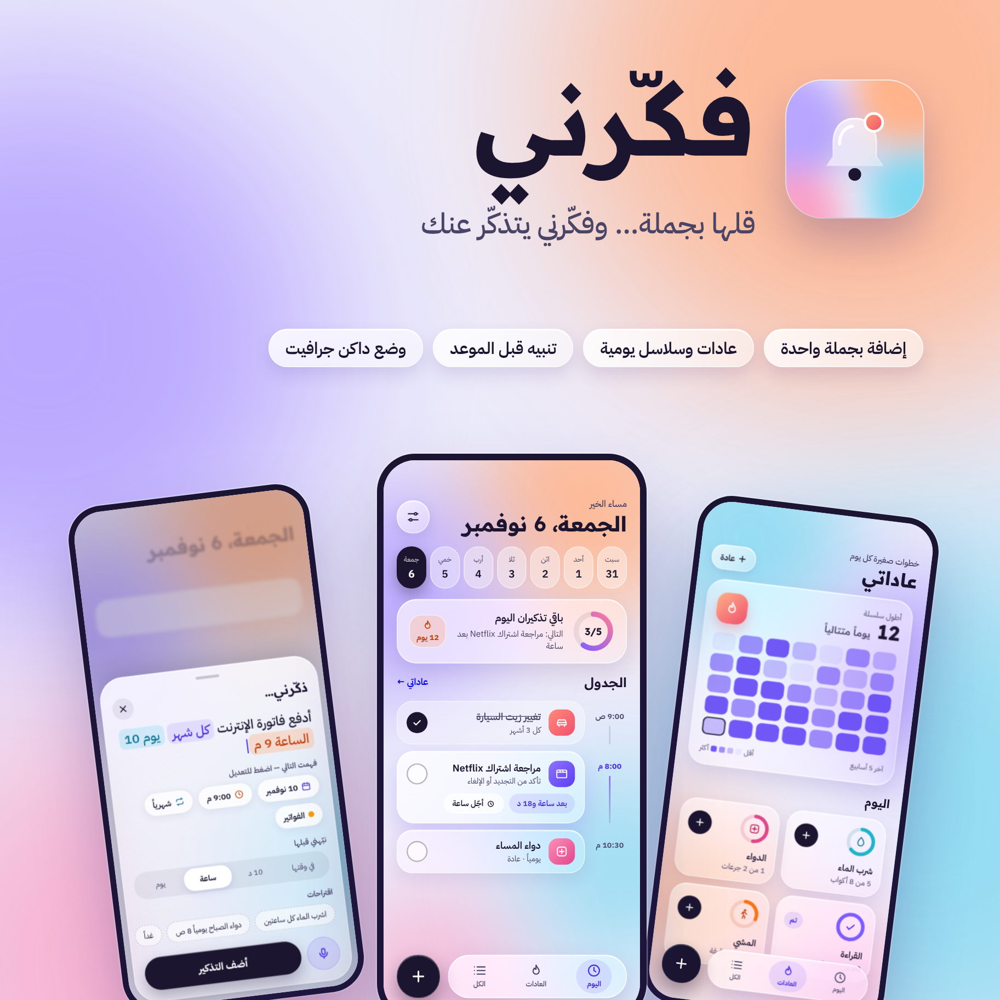

<div align="center">

# فكّرني · Fakkerni

**قلها بجملة… وفكّرني يتذكّر عنك**
*Say it in one sentence — Fakkerni remembers it for you.*



</div>

Fakkerni is an Arabic-first Android app for reminders and daily habits: car maintenance, subscriptions, bills, water, medication, home tasks and personal follow-ups. You type (or say) one sentence, and the app works out the date, time, repeat and category for you.

The interface follows a **Liquid Glass** design: translucent panels with bright edges floating over a soft colour field, in a light theme and a neutral **Graphite** dark theme.

## Features

### Today
- Swipeable week strip, progress ring for the day and a current habit-streak badge.
- A **timeline** of the day's reminders with a continuous time rail; the next one is highlighted with a live countdown and a one-tap **snooze for an hour**.
- A **missed** section for anything overdue.

### Quick add in one sentence
- Type «ادفع فاتورة الإنترنت كل شهر يوم 10 الساعة 9 م» and get a monthly reminder on the 10th at 9 PM, categorised as a bill.
- Understands Modern Standard Arabic, Libyan colloquial and English: today / tomorrow / بكرة, weekdays, day of month, «بعد ساعتين», 12/24-hour times with ص/م, daily / weekly / monthly, and habit counts such as «8 أكواب» or «مرتين».
- Arabic-Indic digits and diacritics are handled; the understood words are **highlighted inline** and summarised as chips you can tap to change.
- **Voice input** through Android speech recognition.
- **Alert me before**: on time, 10 minutes, 1 hour or 1 day early.

### Habits
- Daily habits with a goal (e.g. 8 glasses), logged one tap at a time; long-press to undo the last log.
- Current and longest streak, plus a five-week heatmap of how much of your goals you met.

### All reminders
- Grouped into **Overdue**, **This week**, **Later** and a collapsible **Completed** list.
- Search and category filters.

### Reliable notifications
- Exact alarms through `AlarmManager`, with **Done** and **Snooze** actions on the notification.
- Calendar-correct daily, weekly and monthly recurrence (month-end and leap-day safe).
- Alarms are restored after reboot, app update, clock and time-zone changes.

### Also
- Home-screen widget with upcoming reminders.
- Arabic / English with full RTL, and System / Light / Graphite dark themes.
- Adaptive glass-bell app icon with an Android 13 themed (monochrome) layer.

## Design

| | |
|---|---|
| Visual language | Liquid Glass — translucent gradient panels, specular top edge, soft coloured shadows over a blurred colour field. Built from plain Compose drawing, so it runs on API 26+ with no blur library. |
| Typography | [Readex Pro](https://fonts.google.com/specimen/Readex+Pro) for headings, [IBM Plex Sans Arabic](https://fonts.google.com/specimen/IBM+Plex+Sans+Arabic) for text. |
| Icons | `FakIcons` — a custom rounded line set (24 × 24, 1.9 stroke) shared by the UI and reminder glyphs. |
| Themes | Light: lavender base with peach, lilac, sky and pink blooms. Dark: Graphite `#121214` with a lavender accent `#C4B5FD`. |
| App icon | Glass bell on the Liquid Glass colour field (`design/app-icon.png`). |

## Tech stack

- **Kotlin 2.0** and **Jetpack Compose** (Material 3, Compose BOM 2024.09)
- **Room 2.6** for reminders and completion history, with schema export and migrations
- **AlarmManager** + `BroadcastReceiver` for notifications, and an **AppWidget**
- A lifecycle-aware `FakarniViewModel` exposing `StateFlow`s
- `minSdk 26`, `targetSdk 35`, Java 17

## Project structure

```
app/src/main/java/com/fakarni/app/
├── data/            Room entities, DAO, repository, migrations, QuickParser
├── notifications/   AlarmScheduler, NotificationReceiver, RecurrenceCalculator, SystemEventReceiver
├── ui/
│   ├── components/  Liquid Glass primitives, FakIcons, cards, habit statistics
│   ├── screens/     Today, Habits, All reminders, Settings
│   ├── theme/       Colour schemes, glass tokens, typography
│   ├── AddReminderDialog.kt   Quick-add / edit sheet
│   └── FakarniApp.kt          Navigation, floating dock, dialogs
└── widget/          Home-screen widget
design/              Feature graphic, app icon preview
```

## Build and run

1. Open the project folder in Android Studio and let Gradle sync.
2. Run the `app` configuration on a device or emulator (Android 8.0+).

The package is `com.fakarni.app` and the app name is «فكّرني» (Fakkerni in English).

```bash
./gradlew test             # QuickParser, recurrence and converter unit tests
./gradlew assembleDebug    # debug APK
```

## Data and migrations

The database is `fakarni.db`. Every schema change ships with a migration, so existing reminders are always kept.

| Version | Change |
|---|---|
| 1 → 2 | `completion_events` table for history and streaks |
| 2 → 3 | `isHabit` and `dailyGoal` on reminders; recurring health reminders become habits |
| 3 → 4 | `leadMinutes` for «نبّهني قبلها» |

Installs that predate Room are migrated automatically from the old `SharedPreferences` storage.

## Licences

Readex Pro and IBM Plex Sans Arabic are bundled under the SIL Open Font License 1.1; the licence texts are in `app/src/main/assets/licenses/` and shown in **Settings → Fonts and licences**.
